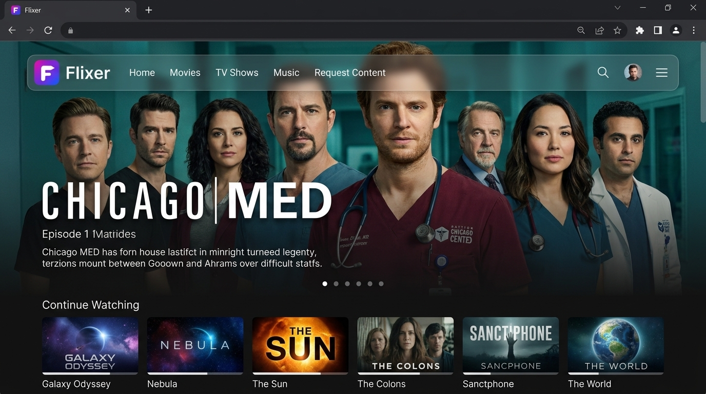
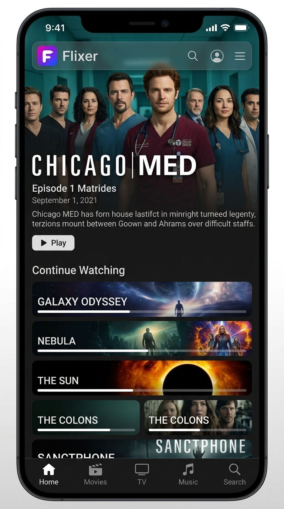

<div align="center">
  
  <h1>Flixer Web</h1>
  <p><strong>The official Vue 3 web frontend for Flixer – a lightning-fast, modern media discovery and streaming client.</strong></p>

  <p>
    <a href="#-preview">Preview</a> •
    <a href="#-features">Features</a> •
    <a href="#-tech-stack">Tech Stack</a> •
    <a href="#-getting-started">Getting Started</a> •
    <a href="#-project-structure">Structure</a> •
    <a href="#-contributing">Contributing</a>
  </p>

  
  
  
  
</div>

---

## 🎨 Preview

Flixer Web provides an immersive, cinematic media experience featuring a floating 10px-margined rounded navigation bar, transparent glassmorphism headers, and fluid multi-device responsiveness.

<div align="center">
  <h3>Desktop View</h3>
  
  <br /><br />
  <h3>Mobile View</h3>
  
</div>

---

## ✨ Features

* **Immersive Glassmorphism UI:** Features a sleek floating navigation bar with a 10px outer margin, rounded corners, and dynamic backdrop blurring over media hero backdrops.
* **Responsive Multi-Device Layout:** Optimised for fluid usage across desktop monitors, tablet touchscreens, and mobile phone browsers.
* **Rich Media Discovery:** Browse trending content, popular movies, episodic TV series, and custom category collections.
* **Instant Search & Navigation:** Real-time query filtering across titles, actors, and genres with zero page latency.
* **Seamless Backend Integration:** Direct communication with the Flixer Backend API for robust streaming indexes and metadata management.

---

## 🛠 Tech Stack

* **Core Framework:** Vue 3 (Composition API)
* **Build Tool:** Vite
* **Routing:** Vue Router with animated sign-in/registration views, session validation, and protected routes
* **State Management:** Pinia
* **Styling:** Tailwind CSS v4 utilities and theme tokens; shared auth fields use reusable Vue components

---

## 🚀 Getting Started

### Prerequisites

Ensure you have the following installed on your local machine:
* **Node.js** (v18.x or higher recommended)
* **npm** or **yarn**

### Installation & Setup

1. **Clone the repository:**
   git clone https://github.com/flixermedia/flixer-web.git
   cd flixer-web

2. **Install dependencies:**
   npm install

3. **Configure environment variables:**
   Optionally create a `.env` file in the root directory to point to your local or hosted Flixer backend instance.
   `VITE_API_BASE_URL` defaults to `/api`; the Vite dev server proxies API requests to
   `http://localhost:8083`. Set it to your hosted backend's API URL when needed. Protected routes validate the saved
   session against `/auth/sessions`; access tokens are kept in tab-scoped session storage and removed when invalid.
   Sign-in is available at `/login`, and account creation is available at `/register`.

4. **Run the development server:**
   npm run dev

5. Open your browser and navigate to `http://localhost:5173`.

### iOS and Android

Flixer Web also includes Capacitor projects for iOS and Android. Web deployment remains the primary build and continues
to use the same-origin `/api` endpoint. On first launch, a native app asks for the Flixer server's HTTPS address and
saves it on that device. The API and streamer must allow the native WebView origin `https://localhost`.

```sh
npm run cap:sync
npm run cap:android
npm run cap:ios
```

Android builds require Android Studio and the Android SDK. iOS builds require macOS and Xcode. Passkeys and web push
notifications are browser/PWA features and are not yet integrated with native platform APIs.

---

## 📁 Project Structure

```text
flixer-web/
├── public/              # Static assets and icons
├── resources/
│   └── examples/        # UI Screenshots & Mockups
│       ├── desktop.jpeg
│       └── mobile.jpeg
├── src/
│   ├── assets/          # Logos and branding elements
│   ├── components/      # Shared components, including LoginForm and RegistrationForm
│   ├── composables/     # Reusable composition functions
│   ├── router/          # Vue Router configuration and authentication guard
│   ├── stores/          # Pinia state management stores
│   ├── views/           # Sign-in/registration flow and protected HomeView
│   ├── api.ts           # Axios API client and authentication helpers
│   ├── tailwind.css     # Tailwind CSS import and Flixer theme tokens
│   ├── App.vue          # Root application component
│   └── main.ts          # Application entry point
└── package.json         # Dependencies and scripts
```

---

## 🤝 Contributing

Contributions are welcome! Feel free to open issues or submit pull requests for new features, bug fixes, or UI enhancements.

1. Fork the Project
2. Create your Feature Branch (`git checkout -b feature/AmazingFeature`)
3. Commit your Changes (`git commit -m 'Add some AmazingFeature'`)
4. Push to the Branch (`git push origin feature/AmazingFeature`)
5. Open a Pull Request

---

## 📄 License

Distributed under the MIT License. See `LICENSE` for more information.
